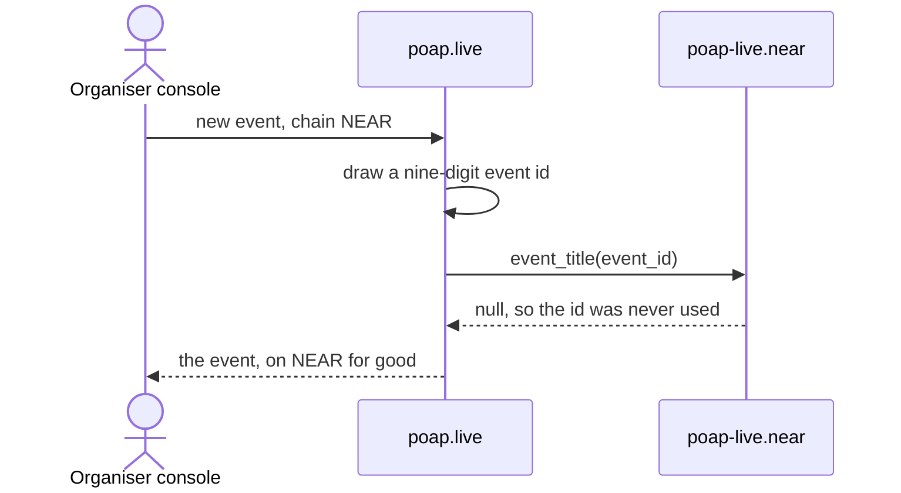
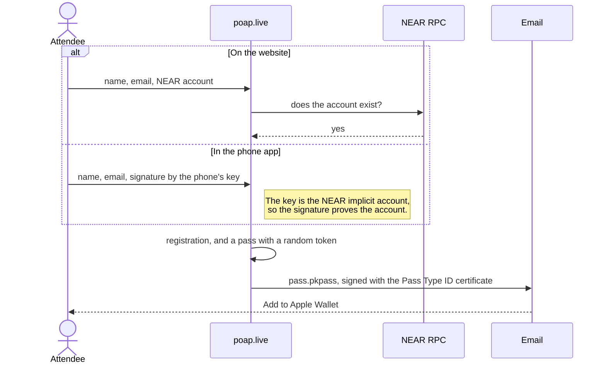
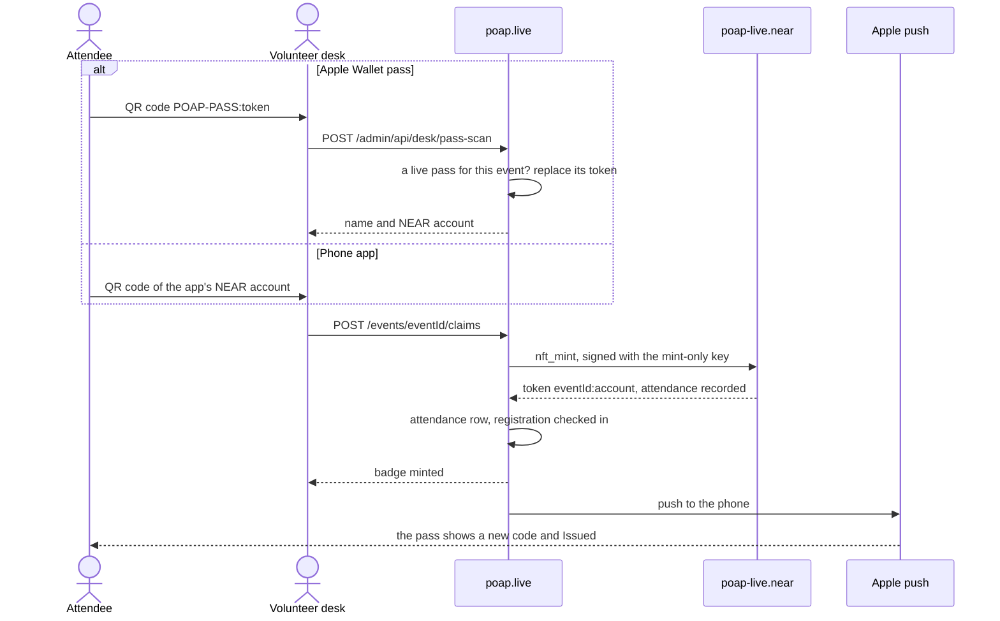
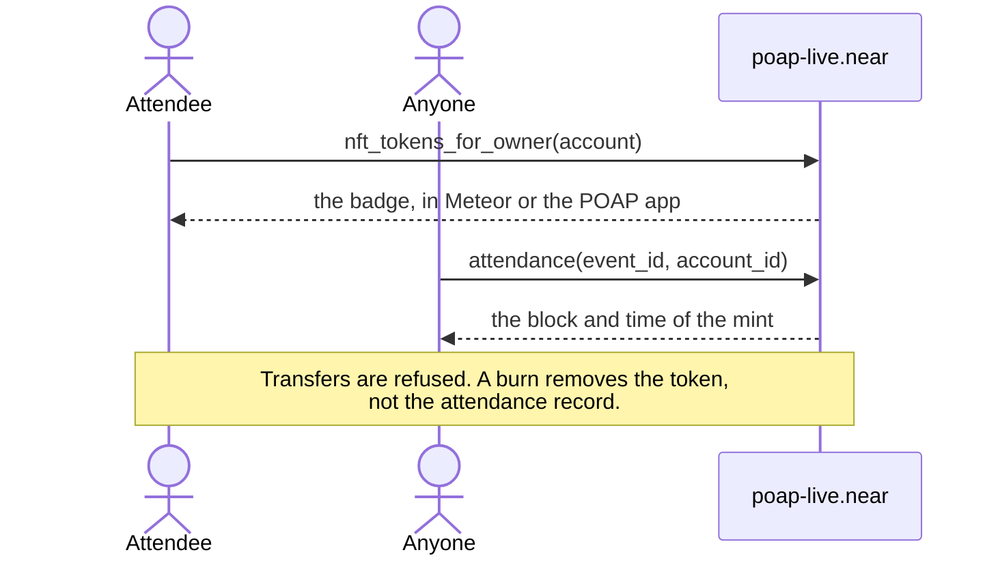
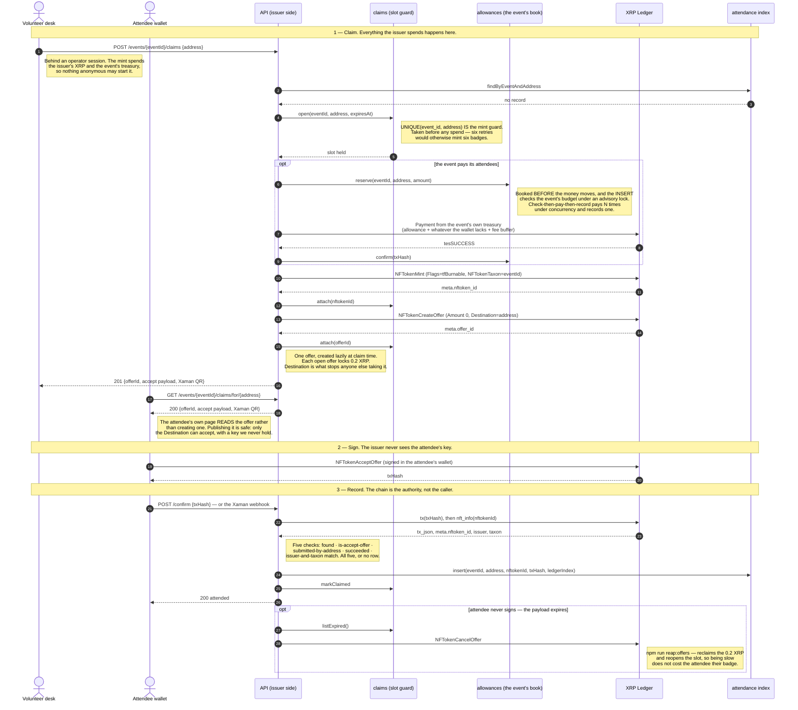
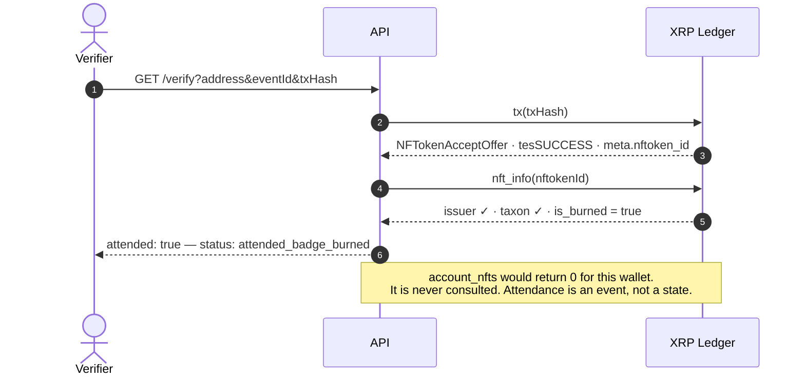
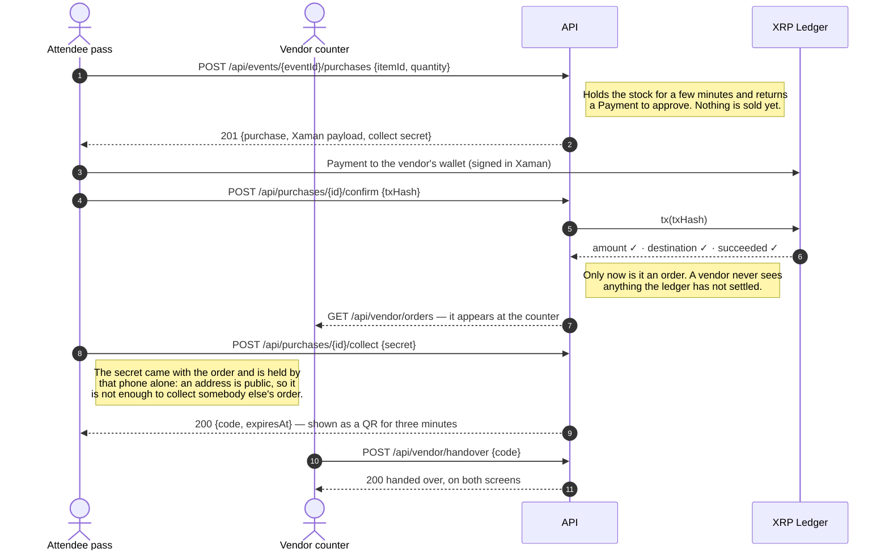

# POAP: attendance badges on NEAR and XRPL

## NEAR HACKATHON submission

**The problem.** Proof-of-attendance badges usually ask people at the door to
install a crypto wallet, approve a popup and pay gas. Most guests give up, so
the badge never reaches them.

**What we built.** An organiser creates an event on [poap.live](https://poap.live)
and picks its chain when creating it, XRPL or NEAR. For a NEAR event:

1. The attendee registers with a name, an email and their NEAR account.
2. They receive an Apple Wallet pass by email. Its QR code is a random token
   that changes on every desk scan, not their account name.
3. A volunteer scans the pass at the door.
4. The server mints a soulbound NFT badge straight into the attendee's NEAR
   account. There is no wallet popup, no gas for the attendee and nothing to
   accept.

Attendees carry the pass one of two ways, and the desk scans either: the
**Apple Wallet pass** from the email, or the **POAP phone app** in
[`mobile/`](mobile). See "Apple Wallet or the POAP app" below.

**How NEAR fits.**

- **One contract for every event.**
  [`contracts/near-badges`](contracts/near-badges) is a Rust (near-sdk) NEP-171
  contract, live on mainnet as
  [`poap-live.near`](https://nearblocks.io/address/poap-live.near).
- **Soulbound.** The contract refuses every transfer; only the holder can burn
  a badge.
- **Attendance is recorded on chain.** `attendance(event_id, account_id)` keeps
  the record even after a burn, so a burned badge still proves attendance.
- **The server can only mint.** It holds a function-call access key limited to
  `nft_mint`, with a capped gas allowance. It cannot move NEAR or change the
  contract.
- **No funding step for attendees.** An implicit account (the 64-character hex
  id of a key) can receive a badge without being funded first.
- **One transaction per badge.** A mint goes straight to the attendee: there is
  no offer to accept, unlike the XRPL flow.
- **Upgradable.** `update_contract` and `migrate` let the contract take new
  code without losing the badges it holds.

### Apple Wallet or the POAP app

| | Apple Wallet pass | POAP app ([`mobile/`](mobile)) |
|---|---|---|
| **What the attendee installs** | Nothing: the pass arrives by email | The POAP app (Expo and React Native, iOS and Android) |
| **Their NEAR account** | Typed when they register; the server checks that it exists | Made on the phone: the app's ed25519 key is a NEAR implicit account, so there is nothing to create or fund |
| **Proof the account is theirs** | The pass's random token, tied to their registration | The registration is signed with the phone's key |
| **The QR at the desk** | `POAP-PASS:` and a token, replaced after every scan | The app's NEAR account, shown only once they have registered |
| **After the desk scans it** | The pass updates itself to say "Issued" | The badge appears on the app's Badges screen, read straight from the contract |

**The POAP app:**

- **Its key stays on the phone.** The key is kept in the keychain for this
  device only, behind a passcode or Face ID, and poap.live never sees it. One
  phone can hold several wallets.
- **One key, two chains.** The same key is an XRPL wallet and a NEAR implicit
  account; for a NEAR event the app uses the NEAR account.
- **Registering comes first.** The attendee registers with a name and an email,
  signed with the key, and the pass opens only after that.
- **Badges come straight from NEAR.** The app reads them from `poap-live.near`
  with `nft_tokens_for_owner`, not through poap.live.
- **The same account works in other NEAR wallets.** The backup screen shows the
  NEAR account id and its private key (`ed25519:…`), so the account, badges
  included, opens in a NEAR wallet such as Meteor.
- **It uses only poap.live's public routes.** Nothing on the server holds an
  app user's key.

**Try the app:**

```
cd mobile
npm install
cp .env.example .env    # EXPO_PUBLIC_API_URL=https://poap.live
npx expo start
```

1. Open it in Expo Go (SDK 57), or in a development build made with
   `npx expo run:ios` or `npx expo run:android`.
2. Make a wallet, and set a passcode.
3. Open "Poap - Near Hackathon 2026" from Events and register with your name
   and email. The pass opens with your NEAR account's QR code.
4. After the desk scans it, the badge shows on the Badges screen.
5. On the Wallet screen, tap "Back up this wallet": "For a NEAR wallet" shows
   the account id and key to import into Meteor.

### The flows on NEAR

Compared with XRPL there is no offer and no accept: the desk mints straight into
the attendee's account, and that mint is the attendance record. The details are
in [docs/near-chain.md](docs/near-chain.md) (the contract and minting) and
[docs/wallet-passes.md](docs/wallet-passes.md) (the pass).

**1. Create.** The organiser picks NEAR, and the event id is chosen for them.



**2. Register.** A name, an email and a NEAR account. The pass goes out by email.



**3. At the door.** The volunteer scans the pass and the badge is minted.



**4. Prove it.** The badge is in the attendee's account, and the attendance stays
on chain even if they burn it.



### Try it

- **Is it live?** Open <https://poap.live/health>. You should see
  `"chains":["xrpl","near"]` and the contract `poap-live.near` on mainnet.
- **Register for the demo event.** Open
  <https://poap.live/register/893690650> ("Poap - Near Hackathon 2026") and
  register with a NEAR mainnet account, your name and your email. The page
  confirms the registration, and an email with an Apple Wallet pass arrives
  (on an iPhone, tap it to add it to Wallet).
- **See that the web page will not make a pass from a typed account.** Open
  <https://poap.live/attend/893690650>. A NEAR event shows no QR code there:
  the pass comes from registering, or from the phone app.
- **Read the contract on mainnet.** This returns the collection's metadata:

  ```
  curl -s https://rpc.mainnet.fastnear.com -H 'content-type: application/json' -d '{"jsonrpc":"2.0","id":1,"method":"query","params":{"request_type":"call_function","finality":"final","account_id":"poap-live.near","method_name":"nft_metadata","args_base64":"e30="}}'
  ```

  The JSON result is in `result.result`, as bytes.
- **The desk scan** needs the organiser login, so the demo video shows it:
  scan the pass, the badge is minted, and the pass on the phone changes to
  "Issued".
- **Run the tests.** These touch no network:
  - `npm install && npm test`: 1,106 server tests, including the NEAR paths
    against a mock NEAR gateway.
  - `cd contracts/near-badges && cargo test`: 31 contract tests.
- **Deploy your own contract on testnet:** `npm run near:deploy`, then
  `npm run e2e:near`. Both are described in
  [docs/near-chain.md](docs/near-chain.md).

### Built during the hackathon, and what came before

This started as an existing product: attendance badges on the XRP Ledger, built
August to October 2026. Under the hackathon rules (Q-002 to Q-004), only the
NEAR work done in the window is meant to be judged.

- **Before the window (baseline).** Tag
  [`pre-hackathon`](https://github.com/team607/xrp-poap/tree/pre-hackathon)
  (`36edae3`, 15 October 2026) holds the XRPL server and pages: Xaman sign-in,
  the organiser console, the volunteer desk, event treasuries and vendors, and
  registering a wallet by signature. The phone app's baseline is commit
  [`23033ba`](https://github.com/team607/xrp-poap/commit/23033ba): the app as
  it stood on 15 October, added under `mobile/` as one commit.
- **During the window, 12 to 14 November 2026.** See
  [the diff from `pre-hackathon` to `hackathon-submission`](https://github.com/team607/xrp-poap/compare/pre-hackathon...hackathon-submission).
  - The NEAR badge contract, made upgradable, with its deploy, upgrade and
    end-to-end scripts.
  - NEAR as a second chain on the server: each event's chain is chosen when it
    is created, the server picks an unused event id on the contract, mints
    with the mint-only key, and checks the attendee in.
  - NEAR in the console, desk, registration, event and pass pages.
  - Apple Wallet passes for every registration: signed passes, sent by email,
    with a QR code that changes on every scan and updates pushed to the phone.
  - Email required to register.
  - NEAR in the phone app: the NEAR account and its private key for wallets
    like Meteor, NEAR badges read from the contract, and registering before
    the pass is shown.
  - The contract deployed to mainnet as `poap-live.near` on 14 November 2026.

### Built with

- **Contract:** near-sdk 5.27 (Rust).
- **Server:** Fastify, zod, PostgreSQL (pg), near-api-js, xrpl, xumm-sdk,
  node-forge (pass signing), nodemailer, @resvg/resvg-js.
- **Phone app:** Expo and React Native, expo-router, expo-secure-store,
  @noble/hashes, @scure/base, ripple-keypairs.
- **Our own baseline code from before the window:** the XRPL product described
  above.

License: [MIT](LICENSE).

---

Everything below describes the XRPL side, as it was before the hackathon.

Attendance badges as soulbound NFTs on the XRP Ledger, and the money an event
hands out around them: every event has a wallet of its own, attendees are paid
an allowance when their badge is issued, and they spend it at the event's
vendors.

Badges are minted with `tfBurnable` and never `tfTransferable`, so nobody can
move one. Attendance is the accept transaction, not current ownership — a
burned badge is still attendance.

The XRPL Commons Make Waves hackathon retrospective (June to September 2026,
three real events, 805 badges on the XRP Ledger) is in
[docs/make-waves-retrospective.md](docs/make-waves-retrospective.md).

## Run it

Node 22 or newer, and Postgres.

```bash
npm install
cp .env.example .env
```

`.env` needs, at a minimum:

| | |
|---|---|
| `XRPL_ENDPOINT`, `XRPL_NETWORK` | a Clio endpoint and the network it belongs to; the server refuses to start if they disagree |
| `ISSUER_SEED`, `ISSUER_ADDRESS` | the minting account. `npm run keygen` makes one offline |
| `XUMM_API_KEY`, `XUMM_API_SECRET` | from apps.xaman.dev — wallets are proven and transactions signed through Xaman |
| `DATABASE_URL` | Postgres |
| `ADMIN_EMAIL`, `ADMIN_PASSWORD_HASH` | the desk and console login. `npm run admin:hash` prints both lines |
| `SESSION_SECRET` | signs the session cookie. `openssl rand -hex 32` |
| `TREASURY_MASTER_KEY` | seals every event wallet's seed. `openssl rand -hex 32`. Without it no event can pay anyone; lose it and the XRP in those wallets is gone |
| `BADGE_BASE_URL` | goes inside every badge's URI, which is immutable. Use a domain you will keep |

Then:

```bash
npm run migrate
npm run dev
```

http://localhost:3000 — `PORT` moves it.

For a click-through on testnet with an issuer it remembers between runs:

```bash
npm run demo
```

## The pages

| | |
|---|---|
| `/` and `/events` | every event, public |
| `/events/:eventId` | one event, its badges read off the ledger |
| `/register/:eventId` | an attendee proves a wallet and signs up |
| `/attend/:eventId` | the attendee's pass: their badge, their allowance, the store, their orders |
| `/volunteer` | the desk: look somebody up, issue their badge. Admin login |
| `/vendor` | the counter: paid orders, handed over by scanning. Vendor wallet login |
| `/admin` | organiser console: events, the event wallet, vendors, rosters. Admin login |

## The flow

Three phases. The issuer spends only in phase 1, never sees the attendee's key
in phase 2, and trusts only the ledger in phase 3.



### Why a burned badge still verifies

Verification replays the attendance transaction. It never asks who holds the
badge now, which is what makes a burn irrelevant.



## Buying at the event

The allowance is the attendee's own XRP once it lands: they pay the vendor
directly, and nothing is handed over until the ledger says the payment
happened.



## Commands

| | |
|---|---|
| `npm run dev` | the server, reloading |
| `npm run demo` | testnet click-through with the demo harness |
| `npm test` | the test suite; nothing in it touches the network |
| `npm run typecheck` | |
| `npm run migrate` | apply migrations; safe to re-run |
| `npm run keygen` | an issuer, offline. Prints the address, writes the seed to a 0600 file |
| `npm run admin:hash` | the operator password hash |
| `npm run e2e:testnet` | the whole flow against testnet, 33 assertions |
| `npm run e2e:burn` | burn behaviour, 13 assertions |
| `npm run check:cutover` | pre-mainnet checks against a running server |
| `npm run reap:offers` | cancel stale claim offers. Dry run unless told otherwise |

The issuer seed and `TREASURY_MASTER_KEY` live in the server's environment and
nowhere else — not in logs, not in responses, not in this repo.
