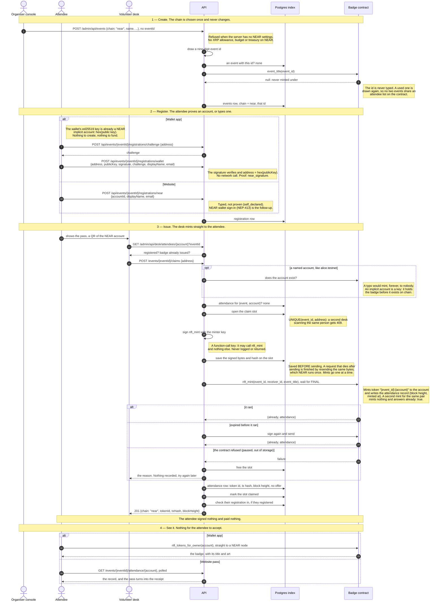
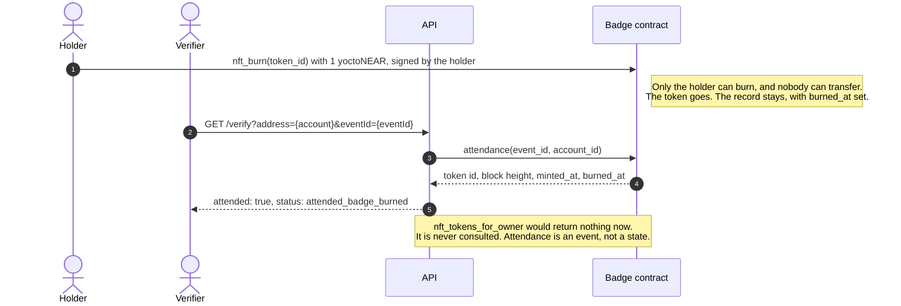

# NEAR as a second chain

An event is created on one chain, XRPL or NEAR, and stays on it. Everything that
already exists for XRPL keeps working unchanged: the default is XRPL, and every
NEAR path is a branch taken only for events whose `chain` is `near`.

## The flow

Four phases. Compared with XRPL (README, "The flow"), the offer, the accept and
the confirm are gone: the desk mints straight into the attendee's account, and
that mint is the attendance record.

### Why a burned NEAR badge still verifies

The contract keeps the attendance record apart from the token. A burn removes
the token; verification reads the record.

## Decisions

### 1. One shared badge contract

The XRP Ledger has NFTs built in: no contract, and an issuer account mints. NEAR
has no native NFTs, so a NEAR badge needs a contract. The CLAUDE.md rule "there
is no smart contract" stays true for XRPL and gets an explicit NEAR exception.

There is one contract for every NEAR event, not one per event. Deploying a
contract costs NEAR and an account per event; a single contract keyed by event
id gives the same isolation with none of the deployment work at the desk.

The contract lives in `contracts/near-badges` (Rust, near-sdk 5). It implements:

| Standard | What it gives wallets |
|---|---|
| NEP-171 core | `nft_token`; `nft_transfer` and `nft_transfer_call` exist but always refuse |
| NEP-177 metadata | contract metadata and per-token title, description and media |
| NEP-181 enumeration | `nft_tokens_for_owner`, `nft_supply_for_owner`, `nft_tokens`, `nft_total_supply` |
| NEP-256 events | `nft_mint` and `nft_burn` logs, which indexers and explorers read |

**Soulbound.** A transfer always fails. The holder can burn their own badge, the
same as `tfBurnable` on XRPL.

**Token ids say what they are.** A badge's token id is `"{event_id}:{account}"`,
for example `70011:alice.testnet`. There is one per person per event, so the id
needs no counter, and a wallet or explorer showing it shows which event and who.

**Attendance survives a burn.** CLAUDE.md: "never verify attendance by current
NFT ownership". The contract keeps an attendance record per
`(event_id, account_id)` with the block height and the time it was minted, and
the time it was burned if it was. A burn removes the token but not the record,
and `attendance(event_id, account_id)` answers from the record.

**One badge per person per event, enforced on chain.** `nft_mint` for an
`(event_id, receiver)` that already has a record returns that record with
`already: true` instead of minting a second one. A retry after a lost response
is therefore safe.

**Upgradable.** The owner can replace the contract's code with
`update_contract`, and the contract account's own key can redeploy it; both
run `migrate` on the new code in the same receipt. See Upgrading below.

**Only minters mint.** The contract owner adds and removes minter accounts; the
contract's own account is a minter from the start. The server signs as the
contract account with a **function-call access key** that may call `nft_mint`
on the contract and nothing else, with a bounded gas allowance. A stolen server
key can therefore mint badges, and cannot move the contract's NEAR, change its
code or call the owner methods. The key is kept like the XRPL issuer seed:
never in logs, responses or errors.

**Storage is paid by the contract.** Rather than attach a deposit to every
mint, the contract account is funded once, and a mint fails with a clear
message if its balance runs short. Measured: a badge for a new holder adds 364
bytes (about 0.0036 NEAR at 1 NEAR per 100 kB), so one NEAR covers about 275
badges. The code itself is about 267 kB, which locks about 2.7 NEAR.

**Built for the protocol as deployed.** Rust 1.82+ emits WebAssembly features
(sign extension, a newer `call_indirect` encoding) that NEAR rejects.
`contracts/near-badges/build.sh` builds with nightly and `-Zbuild-std` for the
MVP target, and the result has none of them.

### 2. Issuing: mint straight to the attendee

On XRPL the desk mints to the issuer, makes an offer only the attendee can take,
and the attendee signs the accept. That accept is the attendance record.

On NEAR none of that is needed. An account can own a token on a contract
without signing anything and without even existing on chain yet. The desk mints
directly to the attendee, and the mint transaction is the record. The attendee
never pays a fee, never signs, and needs no funded account.

So for a NEAR event:

- `POST /events/:eventId/claims` mints and records attendance in one call. There
  is no offer, no Xaman payload and no confirm step. It answers 201 with
  `{ chain: "near", tokenId, txHash, blockHeight, record }`, and 409 when the
  attendee already has the badge.
- `GET /events/:eventId/claims/for/:address` answers 404, as for an XRPL
  attendee with nothing pending.
- `attendance` rows hold the token id in `nftoken_id`, the mint transaction hash
  in `tx_hash` and the contract's block height in `ledger_index`. `offer_id` is
  null.
- The attendee's registration, if they have one, is checked in
  (`checked_in_at`) as soon as the mint is recorded, as XRPL does when the
  attendee's accept is confirmed. Registrations themselves hold the same
  fields on both chains: name, email, the address and how it was proved.

**How a mint is sent, so that a retry never mints twice or loses one.**

1. The claim slot is opened, as for XRPL. A second desk issuing the same person
   at the same moment gets 409 `CONFLICT`.
2. The `nft_mint` transaction is signed, and the signed bytes and hash are saved
   on the claim (`near_tx_hash`, `near_signed_tx`) **before** they are sent. If
   signing or saving fails, nothing was sent, and the slot is freed so the next
   scan starts clean.
3. Mints go out one at a time, so the minter key's nonces stay in order. Every
   RPC call has a time limit (30 s for the send, 10 s for reads) and few
   retries, so one slow node cannot hold every desk.
4. The server waits for `FINAL`. If the answer is lost, a retry sends the same
   saved bytes: NEAR runs a transaction once, so the retry returns the first
   outcome. If the saved transaction can never run (expired, or its nonce was
   used), it is signed again and sent. Should the badge exist by then — this
   slot's own earlier mint, or one from elsewhere — the contract answers
   `already: true` with its record, and that record is indexed under the
   transaction that returned it.
5. If the contract refuses (paused, out of storage), the slot is freed and the
   desk is told why. Nothing is recorded.
6. An event name longer than the contract's 200 bytes (long names in Chinese,
   say, or heavy with accents) is cut to 200 bytes, on a character boundary, for
   the on-chain title.

### 3. Who an attendee is on NEAR

A NEAR account id: either named (`alice.near`, `alice.testnet`) or implicit (64
lowercase hex characters, the ed25519 public key).

- It must belong to the server's NEAR network: `.testnet` names on testnet, and
  not on mainnet. Implicit accounts work on both.
- A named account must exist; the server asks the chain before minting. An
  implicit account need not exist yet: the badge waits for it.
- `0x…` (Ethereum-style) accounts are refused: they are not keys the apps hold.

**The wallet app needs no new key.** Its wallets are ed25519 keys (`sEd…`
seeds). NEAR implicit accounts are ed25519 keys too, so the same key is
a NEAR account: `hex(public key)`. One backup covers both chains, and the
attendee is never asked to make or fund anything.

**Proof of ownership at registration.**
- *Wallet app* (`near_signature`): the phone signs the registration message
  with the same key, and the server checks that the signature verifies and that
  the account id is the hex of the public key. No network call is needed.
- *Website*: there is no NEAR equivalent of Xaman sign-in in the static pages
  yet, so the attendee types their account id (`self_declared`, a proof type
  the schema already has). The cost is small: someone could register a stranger's
  account, and that stranger would get a badge. Signing in with a NEAR wallet
  (NEP-413 through wallet-selector) is the follow-up.

### 4. The event's chain

- `events.chain`, `xrpl` or `near`, default `xrpl` (migration 017).
- Chosen when the event is created; a PATCH that changes it is refused, because
  badges cannot move between chains.
- Creating a NEAR event is refused when the server has no NEAR configuration.
- XRP allowances and budgets are refused for NEAR events: they pay XRP to XRPL
  wallets, which a NEAR attendee does not have. No treasury is generated.
- On NEAR the event id is the contract's `event_id` (u32), so the number in the
  console is the number on chain, as on XRPL.
- A NEAR event's id is picked by the server, never typed
  (`src/near/event-id.ts`). Every server pointed at the contract shares its one
  `event_id` space, and two events with one id would share one attendee list.
  So the id is drawn at random from nine digits (100000000 to 999999999) and
  kept only when no event on this server has it and the contract has never
  minted under it (`event_title` is null). The range stays clear of the ids
  `npm run e2e:near` mints under (1.9 billion up). A create body for a NEAR
  event that names an `eventId` is refused with a 400, and a create is refused
  with a 502 when the contract cannot be read to check the id. An XRPL event
  still takes the id the organiser types.

### 5. Server shape

- `src/near/`: `gateway.ts` (the JSON-RPC client, `NearGateway`, the NEAR twin
  of `XrplGateway`), `badges.ts` (`nearAttendance`, `nearRoster`,
  `signNearMint`), `issue.ts` (`issueNearBadge`, the protocol above),
  `account.ts` (account-id rules) and `wallet-proof.ts` (the
  `near_signature` check). `near-api-js` is pinned to 7.3.1.
- `Chain` and the NEAR types are in `src/types.ts`; the chain-aware address
  checks for routes are in `src/api/http-errors.ts`.
- Routes branch on `event.chain` where the protocol differs: issuing, the
  attendee lookup at the desk, `/claims/for`, verification, the roster, badge
  art and metadata, and registration.
- `/health` adds `chains` and, when configured, `near: { network, contractId,
  rpcUrl }`.
- Config: `NEAR_NETWORK` (testnet or mainnet), `NEAR_RPC_URL`,
  `NEAR_CONTRACT_ID`, `NEAR_MINTER_ACCOUNT_ID`, `NEAR_MINTER_PRIVATE_KEY`. All
  optional; without them the server is XRPL-only, exactly as today.
- Tests use a `MockNearGateway` and never touch the network. Deploying the
  contract (`npm run near:deploy`) and a testnet end-to-end run
  (`npm run e2e:near`) are scripts in `scripts/`, run by hand.

### 6. Pages and apps

- Console: the chain is the first choice on the event form, and fixed once the
  event exists. For NEAR the XRP allowance, budget, treasury and vendors are
  hidden, and the event id is explained as the contract's event number.
- Desk (volunteer page): takes NEAR account ids for NEAR events (lowercased,
  pulled out of `near:` codes), says so when a named account does not exist,
  and shows "Badge minted" as soon as the mint is final.
- Attend page: for a NEAR event, the attendee types their NEAR account, gets a
  pass with that account's QR, and the page turns into their receipt when the
  index has the badge.
- Register page: for a NEAR event, the account is typed beside the name, and
  goes to `POST /api/events/:id/registrations/near`.
- Public event page: says NEAR where it said the ledger.
- Wallet app: shows the NEAR account for NEAR events, registers with
  `near_signature`, reads NEAR badges from the contract.
- Volunteer app: a new attendee on a NEAR event gets an ed25519 key and so a
  NEAR implicit account, with no funding step.

## Deploying

1. `contracts/near-badges/build.sh` (needs nightly Rust and `rust-src`). The
   deploy and upgrade scripts check the result: MVP WebAssembly only, and the
   `migrate` and `update_contract` methods present.
2. The contract account.
   - **Testnet, from nothing:** `npm run near:deploy -- --create-account
     --yes` with `NEAR_CONTRACT_ID=poap-badges-<you>.testnet` asks NEAR's
     testnet faucet to create and fund it. Its full access key is written to
     `secrets/near-deployer.env` before the faucet is asked; the scripts read
     it from there afterwards.
   - **Any network, with a wallet:** create and fund the account yourself
     (about 5 NEAR covers the code and some 600 badges), and pass its full
     access key as `NEAR_DEPLOYER_PRIVATE_KEY`.
3. `BADGE_BASE_URL=https://… npm run near:deploy` reads the chain and prints
   the plan; add `-- --yes` to send it. It deploys, initialises and adds the
   mint-only key in one transaction, and writes the server's four `NEAR_*`
   lines to `secrets/near-minter.env`.
4. `npm run e2e:near` mints one badge to a fresh account and reads it back,
   using `secrets/near-minter.env`.
5. Put those lines in the server's environment and restart. `/health` lists
   `near` among its chains, and the console offers NEAR on new events.

## Upgrading

The contract can take new code without losing anything it holds.

- **How.** `npm run near:upgrade` (dry unless `-- --yes`). By default it
  signs with the contract account's own key (`secrets/near-deployer.env`):
  one transaction that deploys the new code and calls `migrate` on it. With
  `-- --via=owner`, the contract's owner (`NEAR_OWNER_ID`,
  `NEAR_OWNER_PRIVATE_KEY`) calls `update_contract` with the wasm as the
  call's input instead, which works even if the contract account's keys are
  later removed.
- **Atomic.** Either way the deploy and `migrate` are one receipt: if
  `migrate` fails, the old code stays. The script reads owner, minters,
  paused, supply and metadata before and after, and stops if the code hash
  is already the one being deployed.
- **Who.** Only the owner (1 yoctoNEAR, so a full access key) or the
  contract account's own full access key. The server's minting key cannot:
  it may call `nft_mint` only, and cannot attach a deposit.

Rules for a release, so `migrate` stays simple:

- Never reorder, rename the meaning of, or remove `StorageKey` variants:
  each variant's position is the storage prefix of a collection, and a
  changed prefix is a collection that looks empty. Add new ones at the end.
- Adding or changing a field of `Contract` needs `migrate` to read the old
  struct (`env::state_read::<OldContract>()`) and build the new one. Today
  `migrate` reads and writes the same shape.
- Changing `Record` (one per badge) cannot be done in `migrate` for every
  badge at once: read old and new shapes side by side, or version the value.
- Keep `migrate`, `update_contract` and `version` in every release. The
  scripts refuse a wasm without the first two. Bump `VERSION` so the
  upgrade's "before → after" means something.

## Not in this round

- Running the deploy. It needs a funded NEAR account, which the operator
  creates.
- NEAR wallet sign-in on the website (NEP-413).
- A NEAR reward store: the store, vendors and purchases are XRP payments.
