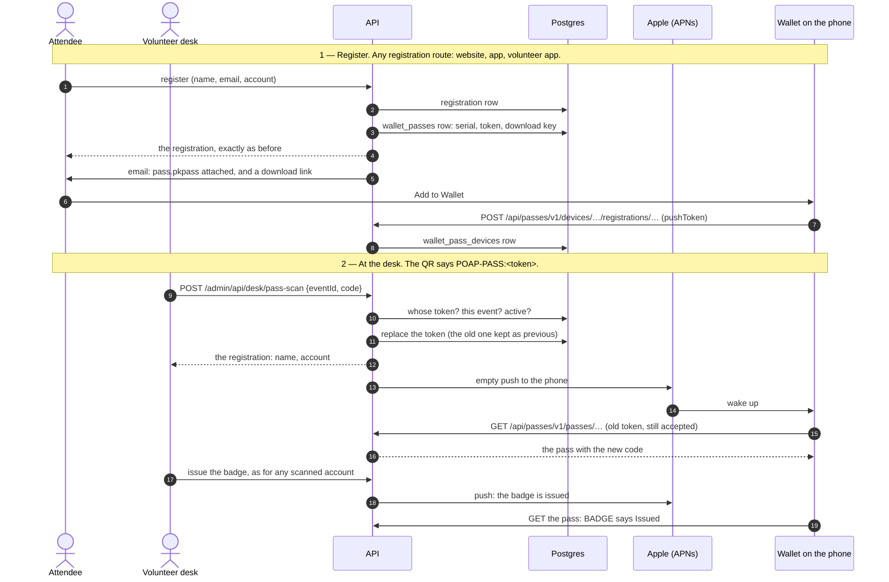

# Apple Wallet passes

Every registration can carry an Apple Wallet pass. The attendee shows it at the
desk, the volunteer scans it, and the badge is issued to the account they
registered — on XRPL or NEAR, without our app. It works the way tessera's
passes do (`/Users/singh/Workspace/Aruba/tessera`, docs 01–04), with a poap
registration as the card holder and its event as the card.

Google Wallet is the next step and is not built (tessera has only a design for it).

## The flow



## What a pass is

An event ticket (`eventTicket` in pass.json): the event's name, the attendee's
name, the date and venue, which chain the badge is on, and on the back the
account the badge goes to. The thumbnail is the attendee's own badge art. The
QR carries `POAP-PASS:<token>`; the prefix is how the desk tells a pass from an
address.

The pass is signed with the Pass Type ID certificate (PKCS #7, detached, over
manifest.json, chained to Apple's WWDR G4 in `src/wallet/assets/wwdr-g4.pem`).
Wallet refuses an unsigned pass.

## Rules

- **One pass per registration**, made when the registration is stored —
  whichever route stores it, through a wrapper around the registration store
  (`withWalletPasses`), so no registration route answers differently.
- **Emailed when there is an email and SMTP**; otherwise the organiser
  downloads it from the console, or resends once SMTP is set up. A failed email
  is written on the pass (`delivery_error`) and never fails the registration.
- **The code changes on every desk scan**, so a screenshot works once at most.
  The previous token stays valid for the phone's own requests, so the phone can
  fetch the pass carrying the new code (tessera's "401 loop" fix).
- **But only when the pass can update**: the server is on https (Wallet calls no
  http web service) and a phone has registered the pass. Otherwise rotating
  would leave the pass showing a dead code, so the code stays.
- **Suspended**: marked SUSPENDED on the phone, refused at the desk, reversible.
  **Revoked** and **expired**: voided on the phone (`voided: true` — iOS ignores
  a 410), refused at the desk, final. Closing an event expires its passes.
- **Editing an event's name, date, venue or description** updates its passes
  on every phone.
- **The badge being recorded** (NEAR mint, or XRPL accept confirmed) updates
  the pass to say Issued.
- **Pushes and emails run after the answer** and never fail a request. A lost
  push is caught up the next time Wallet polls.
- **Logged**: every desk scan (token hashed), every push and Apple's answer,
  and every web-service call (route pattern only).

## Setting it up

```
APPLE_PASS_CERTIFICATE_PATH, APPLE_PASS_PRIVATE_KEY_PATH, APPLE_PASS_KEY_PASSWORD
  — or APPLE_PASS_P12_PATH, APPLE_PASS_P12_PASSWORD
WALLET_PASS_PUBLIC_URL   where the server is reached (defaults to BADGE_BASE_URL)
SMTP_HOST, SMTP_PORT, SMTP_SECURE, SMTP_USER, SMTP_PASSWORD, MAIL_FROM, MAIL_FROM_NAME
```

The pass type identifier and team id are read off the certificate. Startup
fails on a certificate that cannot sign or has expired. Run the migration
(`018_wallet_passes.sql`) before starting.

To get the certificate: in an Apple Developer account, register a Pass Type ID,
create a Pass Type ID Certificate for it, install it in Keychain Access and
export the certificate with its key as a .p12 (tessera docs/01-pass-signing.md,
section 2). Pass images are in `src/wallet/assets` (`npx tsx
scripts/generate-pass-assets.ts` makes them again).

## Code

- `src/wallet/pass.ts` — pass.json and the .pkpass; `signing.ts` — the
  certificate and the signature; `zip.ts`; `apns.ts` — HTTP/2 push with the
  pass certificate; `mailer.ts` — SMTP and the email; `service.ts` — the
  lifecycle; `setup.ts` — built from the configuration.
- `src/api/routes/wallet-passes.ts` — Apple's web service, the download link,
  the console's and the desk's routes.
- `src/db/wallet-pass-repo.ts`, `src/db/migrations/018_wallet_passes.sql`.
- Pages: the desk recognises `POAP-PASS:` codes; the console's registration
  list has a wallet pass column (send, download, suspend, reinstate, revoke);
  the register page says when the pass is on its way.
