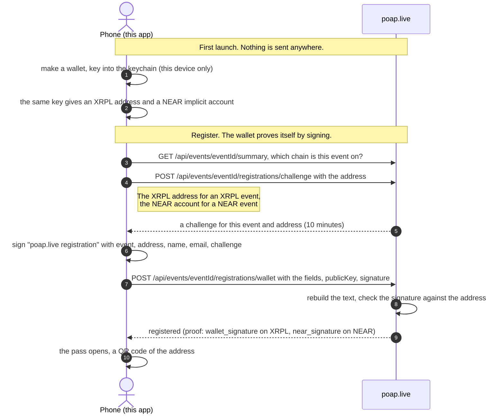
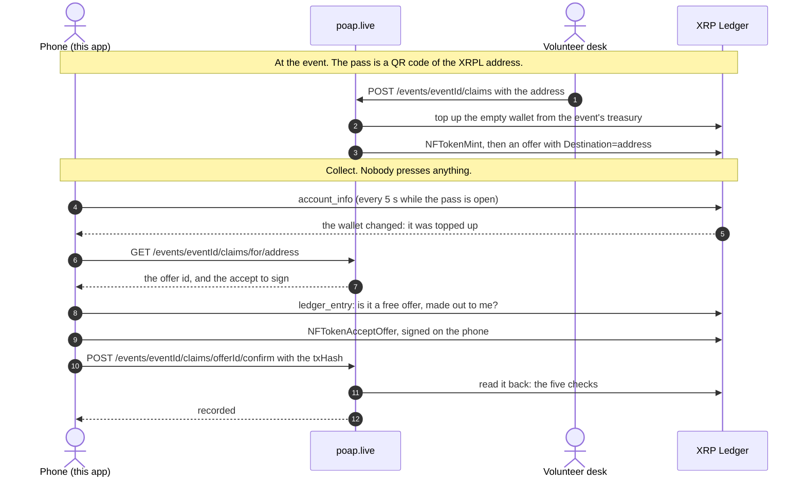
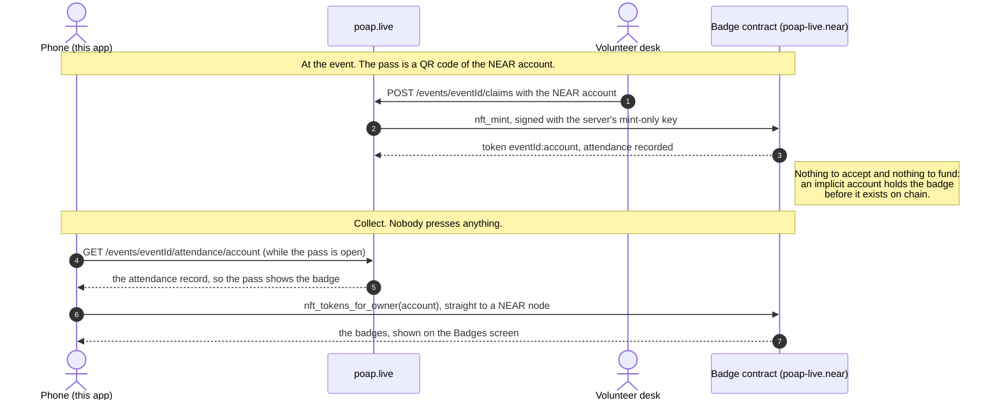

# POAP

The phone app for [poap.live](https://poap.live). Register for an event with
your name and email, show your pass at the desk, and the badge appears in the
app. There is no account and no sign-in, and no wallet app, crypto or seed
phrase to deal with.

An event's badges are on one of two chains, chosen when the event is created:
the **XRP Ledger** or **NEAR**. The app handles both with the same wallet.

Behind that, the app makes a wallet on the phone the first time it opens.
**Its key never leaves the phone**: it is kept in the keychain for this device
only, behind a passcode or Face ID. poap.live never sees it, and nobody else
holds a copy. The one ed25519 key is two things at once:

- **An XRP Ledger wallet** (its classic address). For an XRPL event the phone
  signs the one transaction it ever needs to, accepting the badge, itself.
- **A NEAR implicit account** (the 64-character hex of its public key). For a
  NEAR event the badge is minted straight into that account, so there is
  nothing to sign, accept or fund.

The backup screen shows both: the XRPL seed, and the NEAR account id with its
private key (`ed25519:…`), so the same account opens in a NEAR wallet such as
Meteor.

It uses only poap.live's public routes, the same ones the website's pages use,
including the two that let a wallet register by signing instead of through
Xaman. Registering comes first, on either chain: the pass opens only once the
wallet is registered for the event. poap.live checks everything the app sends
(the signature on a registration, and on XRPL the accept, read back off the
ledger) before it records anything, the same as for anyone else.

It looks like the website on purpose: Plus Jakarta Sans and IBM Plex Mono,
the same paper, ink, signal and jade colours, the calendar date tile, and the
website pass's own QR encoder, so the desk cannot tell the two passes apart.

## The flow

### 1. First launch, and registering (both chains)



### 2. At an XRPL event: the phone accepts the badge



The app trusts poap.live for nothing it signs. Before accepting, it reads the
offer off the ledger and refuses anything that is not a sell offer of nothing
made out to its own wallet. A phone closed halfway finishes the job next time:
an offer already gone is looked for in the wallet's own history before
anything is signed again.

### 3. At a NEAR event: the badge is minted straight to the phone's account



The app signs nothing on NEAR. It asks the contract poap.live names in
`/health`, through the node named there, never through poap.live itself. The
badge cannot be moved: the contract refuses every transfer, and a burn removes
the token but not the attendance record.

## Run it

```bash
npm install
cp .env.example .env
npx expo start
```

Open it in Expo Go (SDK 57) or a development build (`npx expo run:ios` or
`npx expo run:android`). `.env` says which poap.live to use
(`https://poap.live` by default); the app reads it at build time and picks a
public XRP Ledger node on the same network. NEAR's network, contract and node
come from poap.live's `/health`.

What an event needs on poap.live:

| | |
|---|---|
| **An XRPL event** | A funded event treasury. A phone's wallet starts with 0 XRP and needs about 1.2 XRP to hold a badge. The desk tops it up from the event's treasury when it issues, so the event needs `TREASURY_MASTER_KEY` on the server, a budget, and XRP in its event wallet |
| **A NEAR event** | NEAR set up on the server: the badge contract and its mint-only key (`NEAR_*`). Nothing for the phone: a NEAR badge needs no funding |
| **Either** | The wallet-registration routes, on poap.live's `main`. The desk then shows the person's name, marked "wallet proved · poap app" |

Before calling anything done:

```bash
npm run typecheck
npm run lint
```

## Where things are

| | |
|---|---|
| `src/app/` | the screens, one file each (Expo Router) |
| `src/components/` | the pieces from the website: card, chip, date tile, QR plate |
| `src/lib/keys.ts` | making the wallet, signing with it, and its NEAR account and key |
| `src/lib/wallet.tsx` | the keychain, the backup and the restore |
| `src/lib/ledger.ts` | reading the XRPL wallet and submitting the accept |
| `src/lib/collect.ts` | collecting an XRPL badge, step by step |
| `src/lib/near.ts` | reading NEAR badges from the contract |
| `src/lib/registrations.ts` | registering by signing, and what the phone remembers of it |
| `src/lib/api.ts` | every call to poap.live |
| `src/lib/server.ts` | which poap.live the app talks to (mainnet, or testnet from Settings) |
| `src/lib/qr-encoder.js` | the website pass's QR encoder, unchanged |
