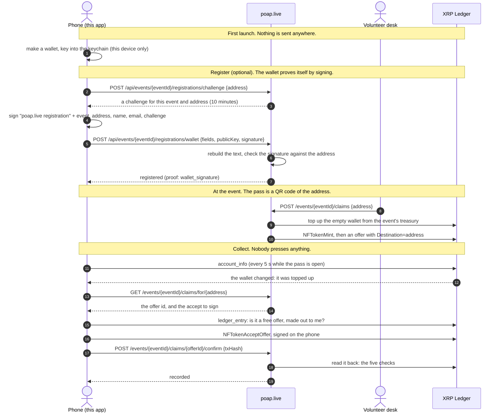

# POAP

The phone app for [poap.live](https://poap.live). Register for an event with
your name, show your pass at the desk, and the badge appears in the app. There
is no account and no sign-in, and no wallet app, XRP or seed phrase to deal
with.

Behind that, the app makes an XRP Ledger wallet on the phone the first time it
opens. **Its key never leaves the phone**: poap.live never sees it, and nobody
else holds a copy. The phone signs the one transaction it ever needs to,
accepting a badge, itself.

It uses poap.live's public routes, the same ones the website's pages use,
plus two that let a wallet register by signing instead of through Xaman
(the `feature/wallet-registration` branch of the poap repo). Registering is
optional: without those routes, or without registering, the desk still issues
to the app's wallet as it would to any walk-up. Either way poap.live checks
the app's accept against the ledger before it records anything, the same as
for anyone else.

It looks like the website on purpose: Plus Jakarta Sans and IBM Plex Mono,
the same paper, ink, signal and jade colours, the calendar date tile, and the
website pass's own QR encoder, so the desk cannot tell the two passes apart.

## The flow



The app trusts poap.live for nothing it signs. Before accepting, it reads the
offer off the ledger and refuses anything that is not a sell offer of nothing
made out to its own wallet. A phone closed halfway finishes the job next time:
an offer already gone is looked for in the wallet's own history before
anything is signed again.

## Run it

```bash
npm install
cp .env.example .env
npx expo start
```

Open it in Expo Go (SDK 57) or a development build. `.env` says which
poap.live to use; the app reads it at build time and picks a public XRP Ledger
node on the same network.

What an event needs on poap.live:

| | |
|---|---|
| a funded event treasury | a phone's wallet starts with 0 XRP and needs about 1.2 XRP to hold a badge. The desk tops it up from the event's treasury when it issues, so the event needs `TREASURY_MASTER_KEY` on the server, a budget, and XRP in its event wallet |
| the wallet-registration routes | for registering in the app: the `feature/wallet-registration` branch and its migration `015_wallet_signature_proof.sql`. The desk then shows the person's name, marked "wallet proved · poap app". Without them, app users arrive as walk-ups with no name |

Before calling anything done:

```bash
npm run typecheck
npm run lint
```

## Where things are

| | |
|---|---|
| `src/app/` | the screens, one file each (Expo Router) |
| `src/components/` | the pieces from the website: card, chip, date tile, QR plate |
| `src/lib/keys.ts` | making the wallet and signing with it |
| `src/lib/wallet.tsx` | the keychain, the backup and the restore |
| `src/lib/ledger.ts` | reading the wallet and submitting the accept |
| `src/lib/collect.ts` | collecting a badge, step by step |
| `src/lib/registrations.ts` | registering by signing, and what the phone remembers of it |
| `src/lib/api.ts` | every call to poap.live |
| `src/lib/qr-encoder.js` | the website pass's QR encoder, unchanged |
